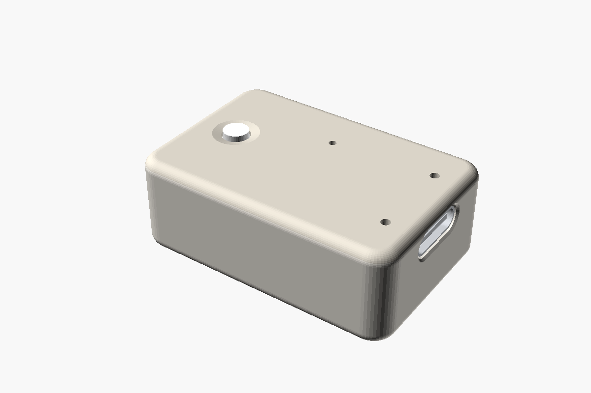
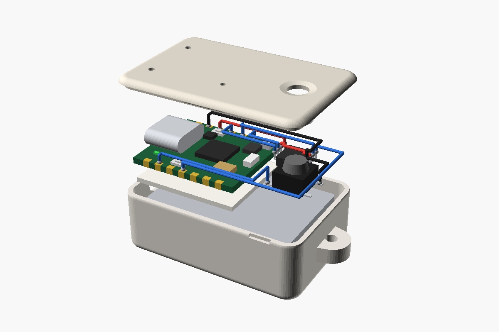
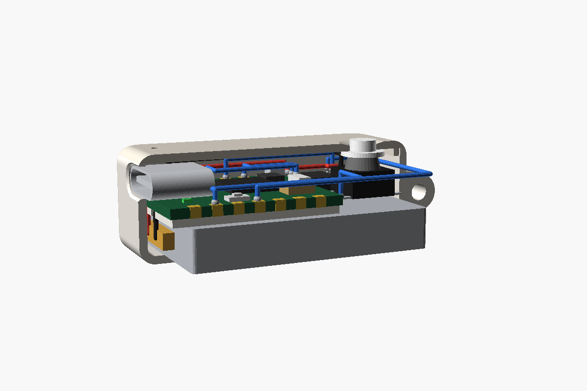
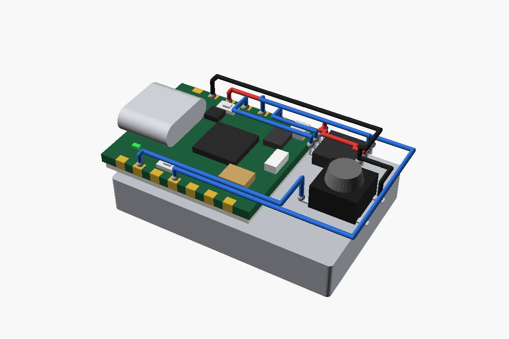
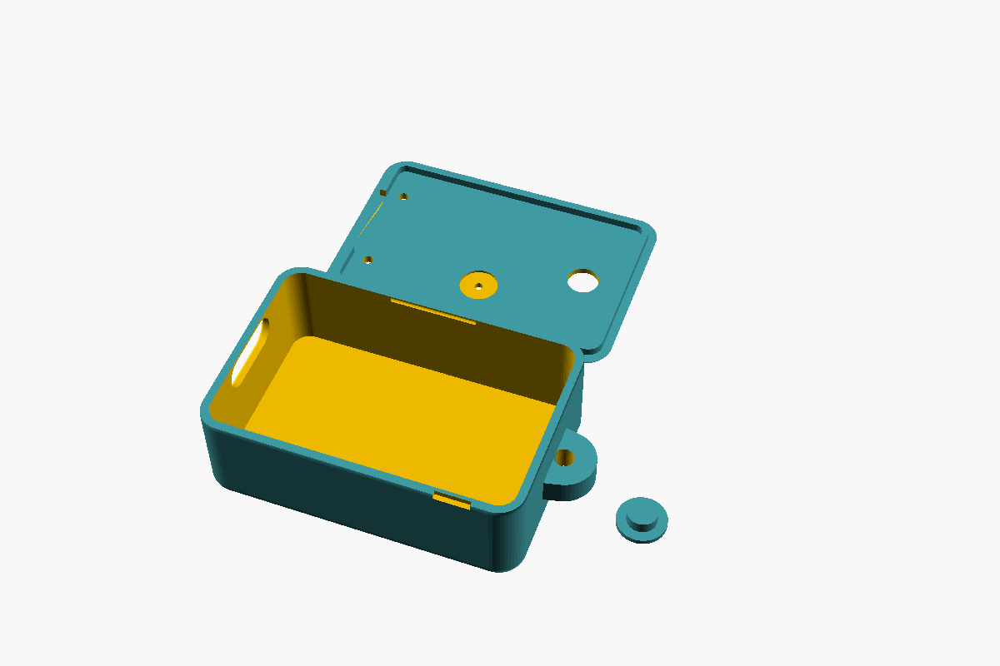

# 케이스

OpenSCAD 파라메트릭 모델([`case/owl-case.scad`](case/owl-case.scad))로 설계해서 3D 프린팅으로 만들어요 (`docs/decisions.md` #50).
> **출력 전에 모델을 고쳐야 해요.** 현재 모델은 실물 확인 전의 추정값이라 USB-C 돌출 길이, 플래시 형태, 보드 위 LED·마이크 위치가 실물과 달라요([아래 표](#실물과-모델의-차이)). 이 파일의 STL과 치수 도면도 같은 추정값으로 만들어졌어요.

모양은 둥근 사각 조약돌(세로 모서리 R3.5, 위아래 모서리 R2), 몸통 + 뚜껑 + 버튼 캡 세 부품이에요. 모델 안에는 보드·배터리·플래시·버튼·배선도 들어 있어서 조립 모습을 미리 볼 수 있어요.

**3D 뷰어**: [Owl 케이스 뷰어](https://claude.ai/artifact/Ly6exwUtzJy4tZDKZR8X52)에서 돌려 보고(위·아래로도 끝없이 돌아가요), WASD로 이동·Q/E로 확대 축소하고, 분해·단면·케이스 투명·핀 이름을 켜고 끄고, 부품을 눌러 설명을 봐요.
로컬에서는 아래 명령으로 띄우고 <http://localhost:8000>을 열어요. 뷰어는 `case/viewer/index.html`, 데이터는 `build.sh`가 만드는 `case/viewer/parts.json` 하나예요.

```bash
python3 -m http.server -d hardware/case/viewer
```



| 분해 | 단면 |
|---|---|
|  |  |



## 크기

- 바깥 **36 × 24 × 13 mm** (PRD N2), 목걸이 고리를 넣으면 길이 40.5 mm
- 안쪽 34 × 22 × 11 mm (세로 모서리 R2, 바닥 모서리 R1). 벽·바닥·뚜껑 1.0 mm, 가장 얇은 곳(바닥 쪽 모서리)은 약 0.8 mm
- 쌓는 순서(아래→위): 배터리 5 → 폼테이프 1.0 → 보드 1.2 → USB-C 3.2 = 10.4 mm, 뚜껑까지 0.6 mm. 그래서 뚜껑 립은 USB-C 위에서 잘라냈어요
- 보드 옆 빈 칸(배터리 위 13 × 22 mm)에 플래시 칩과 버튼
- 무게(추정): 레진 케이스 약 4 g + 배터리 8 g 이하 + 보드 → 15 g 목표(N3) 안쪽

## 구멍과 부품

| 무엇 | 어디 | 메모 |
|---|---|---|
| USB-C | 짧은 면(고리 반대쪽) | 9.4 × 3.8 mm. 리셉터클이 벽 안으로 0.6 mm 들어가요. 케이블 플러그가 끝까지 들어가는지 꼭 확인 |
| 마이크 | 뚜껑, 보드 마이크 위 | 지름 1.0 mm. 뚜껑 안쪽에 방진망 스티커 자리(지름 4.6, 깊이 0.3) |
| LED | 뚜껑, 초록 사용자 LED·빨간 충전 LED 위 | 지름 1.2 mm (D9) |
| 버튼 | 뚜껑, 고리 쪽 | 지름 3.8 mm 구멍 + 손끝으로 찾는 얕은 오목. 버튼 캡이 아래에서 끼워져 날개로 걸려요 |
| 고리 | 짧은 면(USB-C 반대쪽) | 지름 2.2 mm 줄 구멍을 양옆(폭 방향)으로 뚫었어요. 고리 폭 7, 두께 5 mm. 줄이 긴 면과 나란히 지나가서 걸었을 때 뚜껑이 앞을 봐요 |
| 뚜껑 고정 | 립(깊이 1.0)이 몸통 안으로 들어가고, 긴 면의 작은 돌기가 홈에 걸림 | 고리 쪽 긴 면에 손톱 홈 |

버튼은 소프트 터치 6 × 6 × 5 mm(마우저 485-3983 = Adafruit 3983) 기준이에요. 버튼 밑에 폼을 0.4 mm 깔면 버튼 윗면이 캡 날개에 닿아요(OpenSCAD 콘솔에 계산값이 나와요).
택트 스위치를 쓰면 `button` 치수를 바꾸고 버튼 밑 폼 두께를 다시 확인해요 (PRD 10장 D).

## 안쪽 배치와 배선

아래 플래시 설명과 3D 모델은 맨 칩(SOIC-8)을 뒤집어 붙이는 기준이에요. 실제 부품은 [브레이크아웃 보드](wiring.md#플래시-보드)라 모델을 고칠 때 같이 바꿔요.

핀 연결은 [`wiring.md`](wiring.md) 그대로이고, 여기서는 케이스 안에서 어디로 지나가는지를 정해요. 30AWG 실리콘 전선(바깥지름 약 0.6 mm), 빨강 = 전원, 검정 = GND, 파랑 = 신호.

- **배터리 → 보드**: 배터리 −X 끝 보호회로 탭에서 나온 빨강·검정 전선이 USB-C 쪽 벽을 따라 올라가, 폼테이프에 판 홈 두 줄로 보드 밑면 BAT+·BAT− 패드까지 가요. 폼테이프가 1 mm라 전선과 납땜 자국이 들어갈 자리가 생겨요(예전 캡톤 0.3 mm로는 부족)
- **플래시**: SOIC-8을 다리가 위로 오게 뒤집어(dead-bug) 배터리 위에 붙이고, 다리에 직접 납땜해요. 위에서 보면 보드 쪽 줄이 8 VCC · 7 /HOLD · 6 CLK · 5 DI, 바깥 줄이 1 /CS · 2 DO · 3 /WP · 4 GND
  - 3V3 → 8 VCC, D10 → 5 DI, D8 → 6 CLK: 패드에서 올라가 그 다리 높이(y)의 줄로 옮긴 뒤 곧게 +X로 가서 다리에 내려요. 먼 패드일수록 안쪽 줄이라 서로 건너지 않아요
  - D9 → 2 DO: 한 층 위로 플래시를 넘어가 뒤 다리에
  - GND → 4 GND: GND 패드가 USB-C 바로 옆이라 안쪽으로 못 들어가요. 위층에서 가장자리 바깥 줄로 가서 플래시 뒤로 내려와요
  - D3 → 1 /CS: D3만 왼쪽 줄이라 가장자리를 따라 고리 쪽 벽으로 돌아가요. D1은 그 한 줄 안쪽으로 버튼까지
  - 3 /WP는 칩 위를 가로질러 7 /HOLD로, 7 /HOLD는 바로 옆 8 VCC로 점퍼
- **버튼**: 배터리 위에 붙이고, 양옆 탭 2개에 D1과 GND(플래시 4번에서 점퍼)를 이어요. 탭은 방향이 상관없어요
- 모든 선은 직각으로만 꺾어요. 높이는 세 층이에요. 플래시 앞 다리로 가는 선과 왼쪽 줄 선은 보드 위 1.6 mm, 플래시를 넘는 선(DO·GND)은 2.6 mm, 점퍼는 칩 바로 위. 층이 다르니 건널 때 위아래로 지나가요. 실제로는 더 짧고 낮게 붙여도 되지만 같은 순서를 지키면 꼬이지 않아요. 뚜껑을 닫을 때 USB-C 위와 버튼 캡 날개 주변은 비워 두기

## 실물과 모델의 차이

위치는 사진에서 잰 값이에요(±0.5 mm, 보드 좌표. 자세한 내용은 [`wiring.md`](wiring.md#보드-실물-xiao-nrf54l15-v12)).

| 값 | 모델 | 실물 | 영향 |
|---|---|---|---|
| `usb_overhang` | 0.6 | 약 2.4~3 | 벽(1.0)보다 길어요. 보드를 고리 쪽으로 옮겨야 해서 옆 빈 칸이 13 mm보다 줄어요 |
| `flash` | 맨 칩 5.3 × 5.3 × 1.8 | 보드 11.2 × 10.2 × 3.5 | 빈 칸 배치와 배선을 다시 잡아요 |
| `led_user` (`L`) | (3.0, 3.2) | (1.1, 15.1) | 뚜껑 구멍. 지금 보드 위치면 립과 겹쳐요 |
| `led_charge` (`C`) | (3.0, 14.6) | (1.1, 2.8) | 뚜껑 구멍. 지금 보드 위치면 립과 겹쳐요 |
| `mic` | (17.0, 4.0) | 포트 (15.6, 8.3) | 뚜껑 구멍과 방진망 홈 |
| `bat_pads` | BAT+ (9.5, 10.4), BAT− (9.5, 7.4) | BAT+ (15.6, 8.0), BAT− (15.6, 9.9) | 폼테이프 전선 홈, 전선 길이 |
| 버튼 | 다리 4개 | 양옆 탭 2개 | 뷰어 모양과 배선 경로 |
| 금속 캔 | 높이 0.85 칩 | x 5.6–14.0, y 2.4–15.9, 높이 미측정 | 보드 위를 지나는 배선 높이 |

## 부품이 오면 실측할 것

아래 값은 **추정·자리표시**예요. 실측해서 `owl-case.scad` 위쪽 `[부품]` 칸만 바꾸면 돼요.
Seeed 위키의 XIAO nRF54L15 Sense DXF / 3D 파일을 참고해도 돼요.

- `board` PCB 두께, `usb` 높이·튀어나온 길이(`usb_overhang`)
- `led_user`, `led_charge`, `mic`: 보드 위 LED·마이크 위치(보드 좌표, USB-C 쪽 끝·D0 줄 모서리가 원점). **마이크가 윗면 포트인지** 확인
- `bat_pads`: 밑면 BAT+·BAT− 패드 위치. 나머지 보드 부품(`soc`, `imu`, `antenna` 등)은 그림용이라 높이만 맞으면 돼요
- `battery` 실제 크기(보호회로·전선 포함)
- 버튼 높이, 플래시 칩 크기

값이 맞지 않으면(부품이 뚜껑에 닿거나 보드가 모서리에 걸리면) OpenSCAD가 `assert` 메시지로 알려줘요.

## 만들기

```bash
brew install --cask openscad@snapshot
```

```bash
hardware/case/build.sh
```

`build.sh`가 `case/stl/`(owl-body, owl-lid, owl-cap), 뷰어 데이터 `case/viewer/parts.json`, `case/renders/` 그림, 도면 PDF를 다시 만들어요. 값을 바꾸면 모두 다시 만들어 같이 커밋해요.

**치수 도면**: [`case/print-drawing.pdf`](case/print-drawing.pdf) (A4 가로 2쪽: ① 몸통, ② 뚜껑과 버튼 캡). 다른 CAD로 모델을 다시 그리거나 출력 업체에 STL과 같이 보낼 때 써요. 선은 모델을 OpenSCAD로 투상·단면한 그대로이고 숫자는 `owl-case.scad` 값이에요(`case/print_drawing.py`).
부품을 더하거나 이름·색·설명을 바꾸려면 `owl-case.scad`의 `COMPONENTS` 목록을 고쳐요. 뷰어 목록도 여기서 나와요.
OpenSCAD 앱에서 `owl-case.scad`를 열면 오른쪽 Customizer에서 값을 바꾸며 바로 볼 수 있어요(`part`로 조립·분해·부품 보기, `cutaway`로 단면).

출력 방향은 `part = "print"` 그대로예요: 몸통은 바닥을, 뚜껑은 윗면을, 캡은 날개를 바닥에 둬요.



- **추천: 레진(SLA) 또는 MJF 나일론 출력 서비스** — 벽 1.0 mm, 구멍 1.0 mm가 깔끔하게 나와요
- 집 FDM 프린터(0.4 노즐)면 `wall`을 1.2로 올리고 마이크·LED 구멍은 출력 뒤 드릴(1 mm)로 다듬어요. 바깥 크기가 그만큼 커져요
- 뚜껑이 헐겁거나 빡빡하면 `fit`(기본 0.15)을 0.05씩 바꿔요

## 조립 순서

케이스에 넣을 때의 순서예요. 처음 책상에서 시험할 때는 배터리를 맨 뒤에 다는 [`soldering.md`](soldering.md) 순서로 해요.

1. 보드 밑 BAT 패드에 배터리 전선 납땜 (**극성 확인**), 플래시·버튼 배선도 보드 쪽 먼저 납땜
2. 배터리를 몸통 바닥에 붙이고, 배터리 위 보드 자리에 폼테이프 1 mm(전선 홈 두 줄)
3. 보드를 USB-C가 구멍에 맞게 얹고, 플래시·버튼을 배터리 위 빈 칸에 붙인 뒤 납땜. 버튼 밑 폼 두께로 높이 맞추기
4. 뚜껑 안쪽 마이크 홈에 방진망 스티커, 버튼 캡을 아래에서 끼우고 뚜껑 닫기
5. 마이크 구멍을 폼테이프로 막지 않았는지 확인

## 3D펜 (예비)

출력이 어려우면 3D펜으로 만들어요. [`case/pen-drawing.pdf`](case/pen-drawing.pdf)를 A4에 **배율 100%** 로 인쇄해요. 1쪽은 치수와 순서, 2쪽은 따라 그리는 실제 크기 본(바닥, 벽 띠, 뚜껑과 립, 고리, 버튼 캡, 긴 방향·폭 방향 단면)이에요.
값을 바꾸면 `build.sh`가 도면도 다시 만들어요(`case/pen_drawing.py`).

- 부품 위에 직접 그리지 않기 (노즐 180°C 이상, LiPo 근처 위험)
- 안쪽 치수 더미(지우개 34 × 22 × 11, 모서리 R2)에 벽 띠를 감고 마스킹테이프로 덮은 뒤 그리고 빼내기
- 평평한 판은 본 위에 투명 파일을 덮고 그리기. 파일에 닿은 매끈한 면이 바깥이라 뚜껑 본은 위아래가 뒤집혀 있어요
- 안쪽 치수가 기준이에요. 벽이 1.0 mm보다 두꺼워지면 바깥을 갈아요. USB 구멍 둘레가 두꺼우면 플러그가 끝까지 안 들어가요
- LED·마이크 구멍은 채운 뒤 보드를 넣어 위치를 재고 드릴(1 mm)로 뚫기 (위치가 아직 추정값)
- 마이크 구멍은 폼테이프로 막지 않기
