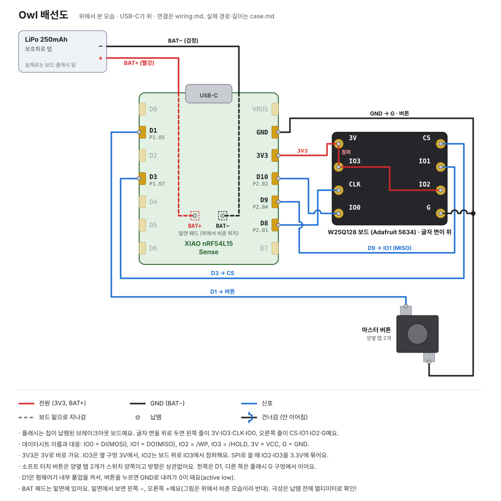

# 납땜 안내 (M0 책상 시험)

케이스에 넣기 전에 책상 위에서 보드, 플래시, 버튼, 배터리를 잇고 동작을 확인하는 순서예요. 핀 연결은 [`wiring.md`](wiring.md)와 같아요. 전선을 넉넉하게 두고, 케이스에 넣을 때 칩 쪽만 다시 납땜해 줄여요([`case.md`](case.md#조립-순서)).

순서: **보드 패드 → 플래시 칩 → 버튼 → 검사 → USB 시험 → 배터리**. 합선 위험이 가장 큰 배터리를 맨 뒤에 달아요.



| 말 | 뜻 |
|---|---|
| 패드 | 보드에서 납땜하는 금색 자리. 양쪽 가장자리에 7개씩, 밑면에 BAT+·BAT− |
| 다리 | 플래시 칩 양옆으로 튀어나온 금속 |
| 탭 | 소프트 터치 버튼 양옆의 납작한 금속 단자. 2개뿐이에요 |
| 플럭스 | 납이 잘 퍼지게 하는 약품. 납땜 직전에 살짝 칠해요 |
| 솔더윅 | 납을 빨아들이는 구리 띠. 잘못 붙은 납을 떼어내요 |
| 도통 모드 | 멀티미터의 삐 소리 모드. 이어져 있으면 소리가 나요 |

## 0. 시작 전

- [ ] USB를 뽑았어요. 배터리는 작업대에서 멀리 뒀어요
- [ ] 창문을 열었어요. 납을 만진 뒤에는 손을 씻어요
- [ ] 보드 앞뒤를 사진으로 찍었어요 (BAT+·BAT− 위치와 보드 버전 확인용. 배선도의 BAT 위치는 추정이에요)
- [ ] 플래시 칩이 양쪽에 다리 4개씩 있는 SOIC-8이에요. 다르면 멈추고 사진부터 확인해요
- [ ] 인두를 최고 온도(300°C)로 2분 데우고 팁에 납을 입혔어요

**기본 동작**

1. 전선 끝 피복을 2 mm 벗기고, 가닥을 꼬아 납을 입혀요.
2. 패드나 다리에 플럭스를 바르고 납을 조금 올려요.
3. 전선을 대고 인두로 2~3초 녹인 뒤 빼요. 식을 때까지 움직이지 않아요.

3초 안에 안 녹으면 인두를 떼고 식힌 뒤, 팁을 닦고 납을 다시 입혀 해요. 이때 계속 누르고 있으면 패드가 떨어질 수 있어요.

## 1. 보드에 전선 7개

전선을 6~8 cm로 잘라요. 파란 선이 5개라 끝에 마스킹테이프로 이름표를 붙여요.

| 순서 | 보드 패드 | 전선 | 갈 곳 | 완료 |
|---|---|---|---|---|
| 1 | GND | 검정 | 칩 4번 | ☐ |
| 2 | 3V3 | 빨강 | 칩 8번 | ☐ |
| 3 | D10 | 파랑 | 칩 5번 | ☐ |
| 4 | D9 | 파랑 | 칩 2번 | ☐ |
| 5 | D8 | 파랑 | 칩 6번 | ☐ |
| 6 | D3 | 파랑 | 칩 1번 | ☐ |
| 7 | D1 | 파랑 | 버튼 | ☐ |

USB-C를 위로 두고 윗면에서 본 패드 배치예요. `←`, `→`가 쓰는 패드예요.

```
            [USB-C]
  D0                5V
→ D1               GND ←
  D2               3V3 ←
→ D3               D10 ←
  D4                D9 ←
  D5                D8 ←
  D6                D7
```

- 전선은 패드 윗면에 눕혀 달아요. 납이 옆면을 타고 밑면까지 넘치지 않게 조금만 써요. 나중에 케이스에서 보드 밑면이 폼테이프에 닿아요
- GND는 열이 잘 빠져서 더 오래 걸려요
- GND, 3V3, D10, D9, D8은 나란히 붙어 있어요. 하나 끝날 때마다 옆 패드와 납이 붙지 않았는지 봐요
- 끝나면 전선을 하나씩 살짝 당겨봐요

## 2. 플래시 칩

칩은 정전기에 약해요. 만지기 전에 금속을 한 번 만지고, 작업 전까지 봉투에 넣어둬요.

**뒤집기 전에 1번 다리를 표시해요.** 칩 윗면의 작은 점과 가장 가까운 다리가 1번인데, 뒤집으면 점이 바닥으로 가려져요.

1. 1번 다리 쪽 칩 옆면에 유성펜으로 표시해요.
2. 칩을 다리가 위로 오게 뒤집고, 위로 온 면의 같은 모서리에도 표시해요.
3. 말아 붙인 마스킹테이프로 칩을 작업대에 고정해요.

표시를 오른쪽 위에 두면 이렇게 보여요.

```
  왼쪽 줄           오른쪽 줄
  8 VCC    [칩]    1 /CS   ← 표시한 다리
  7 /HOLD  [칩]    2 DO
  6 CLK    [칩]    3 /WP
  5 DI     [칩]    4 GND
```

다리 간격이 1.27 mm라 가장 어려운 단계예요. 납은 아주 조금 쓰고, 다리 하나를 하면 몇 초 식혀요. 옆 다리와 붙으면 플럭스를 바르고 솔더윅으로 떼요.

아래 순서대로 달아요. 점퍼는 같은 칩의 다리끼리 잇는 짧은 전선이에요.

- [ ] 점퍼: 8번 ↔ 7번, 짧은 빨간 선
- [ ] 점퍼: 7번 ↔ 3번, 피복이 있는 빨간 선으로 칩 위를 가로질러요
- [ ] 8번 ← 3V3 (점퍼가 떨어지지 않게 짧게)
- [ ] 6번 ← D8
- [ ] 5번 ← D10
- [ ] 2번 ← D9
- [ ] 1번 ← D3
- [ ] 4번 ← GND

## 3. 버튼

소프트 터치 버튼(Adafruit 3983)은 다리 대신 양옆에 납작한 금속 탭이 하나씩 있어요. 탭 2개가 스위치의 양쪽이고, 방향은 상관없어요.

- [ ] 납땜 전에 도통 모드로 두 탭을 재요. **누를 때만** 소리가 나야 해요
- [ ] 누르는 고무 부분이 위로 오게 놓고, 몸통 옆면을 마스킹테이프로 고정해요
- [ ] 탭 윗면에 납을 입혀요. 플럭스는 아주 조금만 써요. 몸통 안으로 스며들면 스위치 접점이 망가질 수 있어요
- [ ] 한쪽 탭에 D1 선을 달아요
- [ ] 반대쪽 탭을 짧은 검정 선으로 칩 4번에 이어요
- [ ] 식은 뒤 다시 재요. 전선 끝끼리 **누를 때만** 소리가 나야 해요

몸통은 플라스틱과 실리콘이라 인두가 닿지 않게 하고, 탭 하나에 2초 안쪽으로 끝내요. 택트 스위치(다리 4개)를 쓰면 대각선 두 다리에 같은 방법으로 달아요.

## 4. 전원 넣기 전 검사

USB를 뽑은 상태에서 도통 모드로 재요. 이 검사가 보드를 지켜줘요.

**소리가 나야 해요**

- [ ] 3V3 ↔ 칩 8, 7, 3번
- [ ] GND ↔ 칩 4번
- [ ] D8 ↔ 6번, D10 ↔ 5번, D9 ↔ 2번, D3 ↔ 1번
- [ ] D1 ↔ GND: 버튼을 누를 때만

**소리가 나면 안 돼요**

- [ ] 3V3 ↔ GND: 처음에 잠깐 나는 건 괜찮고, **계속** 나면 합선이에요
- [ ] 칩 3번 ↔ 4번 (3번이 3V3, 4번이 GND라 붙으면 합선이에요)
- [ ] 칩 1↔2, 2↔3, 5↔6, 6↔7번
- [ ] 보드의 나란한 패드끼리: GND↔3V3, 3V3↔D10, D10↔D9, D9↔D8

하나라도 틀리면 USB를 꽂지 말고 고쳐요.

## 5. USB 꽂고 확인

탄 냄새가 나거나 칩이 뜨거워지면 바로 뽑아요. 정상이면 대시보드를 켜고 <http://localhost:8765>를 열어요.

```bash
python3 tools/bringup_monitor.py
```

| 동작 | 정상 결과 | 완료 |
|---|---|---|
| **보드 리셋** 누르기 | 외부 플래시 `ef 40 18`, 통과 | ☐ |
| 버튼 짧게 누르기 | 버튼 (D1) 통과 | ☐ |
| 버튼 5초 누르고 떼기 | System OFF 깨우기가 "꺼짐", LED 꺼짐 | ☐ |
| 버튼 다시 누르기 | System OFF 깨우기 통과 | ☐ |

| 증상 | 먼저 볼 곳 |
|---|---|
| 플래시 "응답 없음" (`flash: not ready`) | USB를 뽑고 4번 검사를 다시 해요. 칩 방향, D3 ↔ 1번, 3V3 ↔ 8번 순서로 |
| 플래시가 `ef 70 18` | 배선은 정상이고 칩 변형이 달라요. overlay의 `jedec-id`를 바꿔야 해요 |
| 지우기·쓰기·읽기 실패 | 3번 /WP, 7번 /HOLD가 3V3에 이어졌는지 |
| 버튼 반응 없음 | D1 납땜, 버튼 탭 두 곳의 납땜, 칩 4번 점퍼 |
| 보드가 안 보여요 | USB를 뽑고 3V3 ↔ GND 합선부터 |

## 6. 배터리 (마지막)

- [ ] USB를 뽑았어요
- [ ] 배터리 빨강·검정 선이 서로 닿지 않아요. 끝을 자를 때는 **한 번에 한 가닥만** 자르고, 다른 가닥 끝은 캡톤 테이프로 감아둬요
- [ ] 멀티미터 전압 모드로 빨간 리드를 빨간 선에, 검은 리드를 검은 선에 대서 **+3.x~4.2 V**가 나왔어요. 값이 음수면 색이 바뀐 거니 멈춰요
- [ ] 보드 인쇄로 밑면 BAT+·BAT− 위치를 확인했어요
- [ ] 패드 두 곳에 납을 먼저 입혔어요
- [ ] BAT− ← 검정
- [ ] BAT+ ← 빨강

배터리 몸체는 인두에서 멀리 두고 인두는 잠깐만 대요. 반대로 달면 보드가 바로 망가질 수 있어요. 배터리가 부풀거나 뜨거워지면 작업을 멈춰요.

다 달면 USB를 꽂고 **보드 리셋**을 눌러 배터리 전압을 봐요. 그다음 시리얼 로그를 끈 기본 빌드를 구워 USB를 빼고 배터리만으로 부팅되는지 확인하면 M0가 끝나요([`firmware/README.md`](../firmware/README.md#m0--부품-bringup)).
