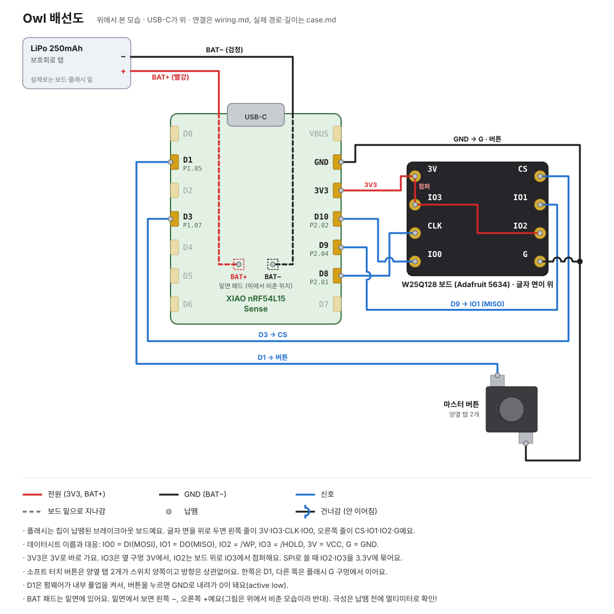

# 배선

보드: XIAO nRF54L15 Sense (21 × 17.8 mm). 핀 번호는 `firmware/boards/*.overlay`와 같아야 해요. 케이스 안에서 전선이 지나가는 길은 [`case.md`](case.md#안쪽-배치와-배선), 단계별 납땜 순서와 검사는 [`soldering.md`](soldering.md).



납땜할 때 옆에 두고 보는 그림이에요. 핀 배열과 연결은 실물대로이고, 선 경로는 보기 좋게 정리한 거예요(실제 경로·길이는 case.md). 플래시는 실제 부품인 브레이크아웃 보드를 글자 면에서 본 모습이에요. 이 핀 순서로 평면에 그리면 선 네 군데가 꼭 건너야 해서, 건너는 곳은 반원으로 표시했어요. 그림은 `python3 hardware/wiring_svg.py`로 다시 만들어요.

| 부품 | 부품 핀 | XIAO 핀 | nRF 핀 |
|---|---|---|---|
| W25Q128 플래시 보드 | CLK | D8 | P2.01 |
| | IO1 (DO, MISO) | D9 | P2.04 |
| | IO0 (DI, MOSI) | D10 | P2.02 |
| | CS | D3 | P1.07 |
| | 3V, IO2 (/WP), IO3 (/HOLD) | 3V3 | |
| | G | GND | |
| 마스터 버튼 | 한쪽 | D1 | P1.05 (내부 풀업) |
| | 다른 쪽 | GND | |
| 배터리 250mAh | + (빨강) | 밑면 BAT+ | |
| | − (검정) | 밑면 BAT− | |

보드 내장: PDM 마이크(P1.12 CLK / P1.13 DAT), IMU(I2C30), 배터리 전압(AIN7 = P1.14, 1/2 분압, P1.15로 켜는 부하 스위치), 사용자 LED(초록, P2.00), USR 버튼(P0.00).

회로도 V1.2 기준으로 **nRF가 읽을 수 있는 충전 상태 핀과 USB 꽂힘 감지 핀은 없어요.** 빨간 충전 LED는 충전 칩(SGM40567)이 직접 켜요.

## 플래시 보드

Adafruit 5634(QSPI DIP 브레이크아웃, 칩 W25Q128JVSSIQ)예요. 칩은 이미 납땜돼 있고 구멍 8개에 전선을 달아요. 글자 면에서 본 배치예요.

```
3V    CS
IO3   IO1
CLK   IO2
IO0   G
```

3.3V 전용이라 `VBUS`에 연결하면 안 돼요. Adafruit 문서에 따라 SPI로 쓸 때는 IO2·IO3을 3.3V에 묶어요. 함께 온 핀 헤더는 안 써요. 크기는 Adafruit 표기로 11.2 × 10.2 × 3.5 mm예요.

## 보드 실물 (XIAO nRF54L15 v1.2)

보드 밑면 인쇄가 `XIAO nRF54L15 v1.2`예요. 아래 좌표는 사진에서 패드 간격(2.54 mm)을 자로 삼아 잰 값이라 ±0.5 mm쯤 틀릴 수 있어요. x는 USB-C 쪽 PCB 끝에서, y는 D0 줄 가장자리에서 재요.

**핀 이름**: 인쇄에는 `5V` 대신 `VBUS`로 적혀 있어요(USB 전원, 약 5V). 밑면에서 보면 왼쪽 줄이 VBUS·GND·3V3·D10·D9·D8·D7, 오른쪽 줄이 D0–D6으로, 윗면과 좌우가 반대예요.

| 윗면 | 위치 (x, y) | 메모 |
|---|---|---|
| USB-C | PCB 끝에서 약 2.4~3 mm 밖으로 나옴 | 자로 다시 재기 |
| LED `C` | (1.1, 2.8) | 이름으로 보아 충전 LED |
| LED `L` | (1.1, 15.1) | 이름으로 보아 사용자 LED |
| 금속 캔 모듈 | x 5.6–14.0, y 2.4–15.9 | 높이는 아직 안 쟀어요 |
| 버튼 `R` | (15.8, 4.7) | |
| 버튼 `B` | (15.4, 13.8) | |
| PDM 마이크 포트 | (15.6, 8.3) | 윗면에 구멍이 보여요 |
| U.FL | (19.3, 4.9) | |
| 칩 안테나 | (19.6, 13.0) | |

| 밑면 | 위치·이름 | 메모 |
|---|---|---|
| `BAT+` | (15.6, 8.0) | 약 1.1 × 2.1 mm 평평한 패드 |
| `BAT−` | (15.6, 9.9) | 밑면에서 보면 BAT− 왼쪽, BAT+ 오른쪽 |
| 둥근 패드 | SWCLK, SWDIO, GND, RST, SWCLK2, SWDIO2, 3V3, RST2 | 안 씀 |
| 큰 둥근 패드 | D11–D15 | 안 씀 |
| `N1`, `N2` | 긴 패드 | 안 씀 |

## 주의

- 배터리 납땜 전 **멀티미터로 극성 확인**. 반대로 연결하면 보드가 바로 손상될 수 있어요
- 충전 전류는 보드에서 **200mA 고정** (R=120kΩ). 배터리는 1C ≥ 200mA인 것만
- 플래시 보드는 정전기 방지 봉투에 보관
